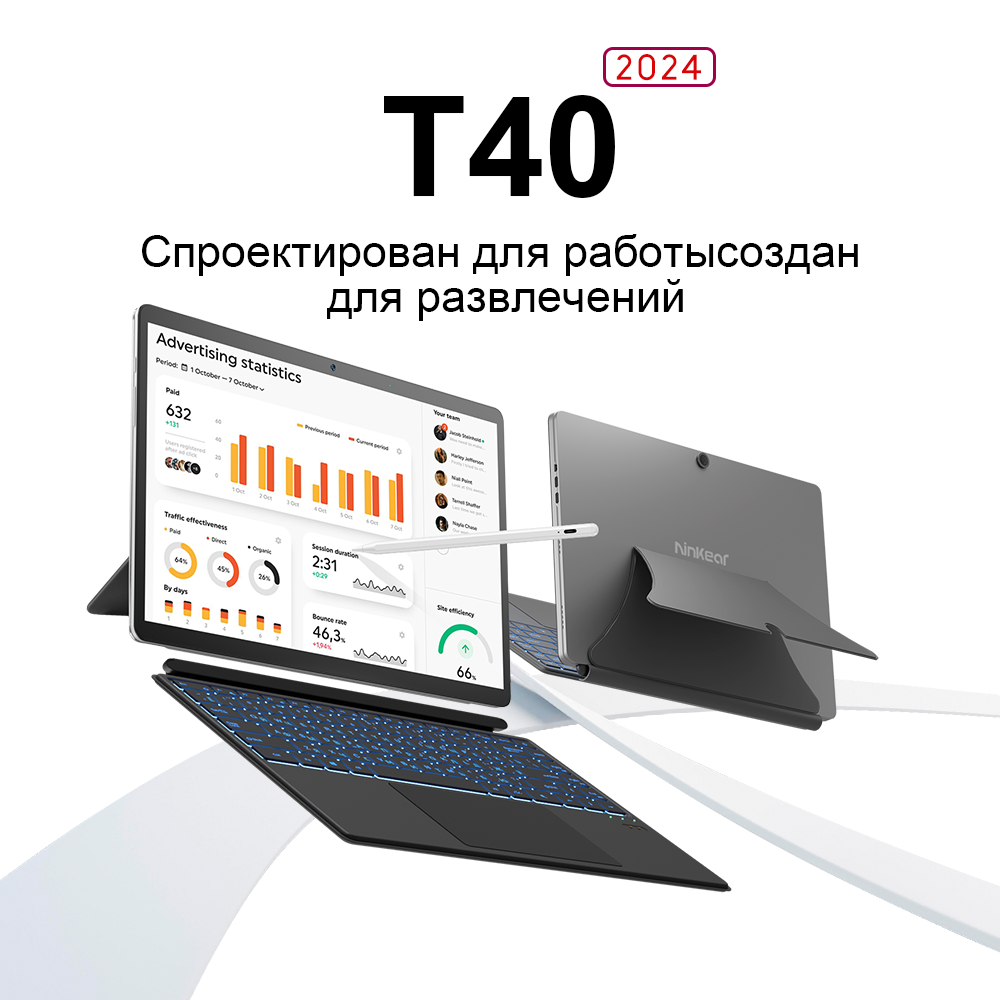

# LaptopAccelRotate

**English** · [Русский](README.ru.md)

<p align="center">
  
</p>

<p align="center">
  <sub>Ninkear T40 (2024) — the convertible this was written and debugged on.<br>
  Image is the manufacturer's promotional photo.</sub>
</p>

Screen auto-rotation for Windows tablets and convertibles whose built-in rotation
stopped working even though the accelerometer is perfectly fine.

The program reads the sensor itself and rotates **only the internal panel** — external
monitors stay exactly as they were.

---

## Why this exists

A classic breakage after reinstalling Windows: the system is missing the sensor-hub
driver that connects the accelerometer to the rotation subsystem. The sensor itself
still works and happily reports data — check it like this:

```powershell
[void][Windows.Devices.Sensors.Accelerometer, Windows.Devices.Sensors, ContentType = WindowsRuntime]
[Windows.Devices.Sensors.Accelerometer]::GetDefault().GetCurrentReading()
```

If that returns `AccelerationX/Y/Z` but the screen never rotates, this program fills the
gap: it pulls the data straight from WinRT and rotates the display through the Win32 API.

### Tested hardware

The specific machine this was built for is a **Ninkear T40 (2024)**:

| | |
|---|---|
| CPU | Intel N100 |
| Form factor | tablet with a magnetically detachable Bluetooth keyboard |
| Display | 2K internal panel, enumerated as `\\.\DISPLAY1` |
| Sensor | accelerometer reachable via WinRT, but no sensor-hub driver |

Auto-rotation worked on the factory Windows install. After a clean reinstall the chip
driver never came back, so the built-in rotation disappeared — while the accelerometer
kept reporting data just fine. This program replaces the missing link.

The code knows nothing about this particular model and should work on any Windows tablet
or convertible with a WinRT-accessible accelerometer.

## Features

- Accelerometer-driven auto-rotation with debouncing.
- **Rotates the internal panel, not the "primary" display.** This is the whole point: if
  an external monitor is set as primary, a naive implementation rotates the monitor
  instead of the laptop screen.
- Manual display override in the UI, in case detection ever guesses wrong.
- Tracks monitors being plugged and unplugged (`WM_DISPLAYCHANGE`).
- "Swap left and right" toggle, for panels mounted mirrored.
- Starts with Windows, lives in the system tray.
- Manual rotation from the window while auto-rotation is off.
- No administrator rights required.

## How it works

Two parts:

1. **Background process** — `powershell.exe` running `worker.ps1`, which the program drops
   into `%LOCALAPPDATA%\AutoRotate\` itself. The script does exactly one thing: read
   `Windows.Devices.Sensors.Accelerometer` and print `X;Y;Z` to standard output.
   PowerShell is used only because it's the shortest path to the WinRT API without
   pulling in third-party libraries.

2. **Main application** (`AutoRotate.exe`) — reads that stream and decides what to do.
   All rotation logic lives here and nowhere else.

### Picking the display

This is the crux. `EnumDisplayDevices` can only tell you "this display is primary", never
"this display is internal". So the built-in panel is located through the CCD API
(`QueryDisplayConfig` + `DisplayConfigGetDeviceInfo`) by video output technology:

| Constant | Value |
|---|---|
| `DISPLAYCONFIG_OUTPUT_TECHNOLOGY_INTERNAL` | `0x80000000` |
| `DISPLAYCONFIG_OUTPUT_TECHNOLOGY_DISPLAYPORT_EMBEDDED` | `11` |
| `DISPLAYCONFIG_OUTPUT_TECHNOLOGY_UDI_EMBEDDED` | `13` |

The matching target is mapped back to its GDI name (`\\.\DISPLAY1`), and the
`ChangeDisplaySettingsEx` call is addressed strictly to that device.

If there is no internal panel at all (a desktop PC, say), the program falls back to the
primary display.

### Determining orientation

From the accelerometer readings:

- `|Z| > 0.88` — the device is lying flat, orientation is undefined, rotation is left alone.
- `Y < -0.55` — landscape, `Y > 0.55` — landscape flipped.
- `X < -0.55` and `X > 0.55` — portrait orientations; which one depends on the
  "swap left and right" setting.

A rotation is only applied after two consecutive matching readings — otherwise the screen
would flip on every accidental tilt.

## Building

All you need is .NET Framework 4, which ships with Windows. No NuGet, no Visual Studio,
no external dependencies.

```bash
build.bat
```

The batch file locates `csc.exe` on its own and builds `AutoRotate.exe` with the icon.
Or by hand:

```bash
%WINDIR%\Microsoft.NET\Framework64\v4.0.30319\csc.exe /target:winexe /optimize+ /out:AutoRotate.exe /win32icon:AutoRotate.ico /reference:System.dll /reference:System.Drawing.dll /reference:System.Windows.Forms.dll AutoRotate.cs
```

## Usage

Double-click `AutoRotate.exe` and press "Включить" (Enable).

- Closing the window minimizes the program to the tray; it keeps running.
- Quit through the tray icon's context menu.
- The "start with Windows" checkbox registers the program with the `/auto` switch, so it
  launches minimized and starts watching immediately.

Command-line switch:

| Switch | Effect |
|---|---|
| `/auto` | Enable auto-rotation immediately and minimize to tray |

> The user interface is in Russian. If you need it in English, the strings are all plain
> literals in `AutoRotate.cs` — search for `"Автоповорот"` and work outwards.

## Settings

Stored under `HKEY_CURRENT_USER\Software\AutoRotate`:

| Value | Type | Meaning |
|---|---|---|
| `Swap` | DWORD | `1` — swap left and right (default) |
| `Screen` | String | Display name, e.g. `\\.\DISPLAY1`. Empty — detect the internal panel automatically |

Autostart lives in `HKEY_CURRENT_USER\Software\Microsoft\Windows\CurrentVersion\Run`,
value `AutoRotate`.

## Troubleshooting

- **Nothing rotates at all.** Check Rotation lock in Settings → System → Display.
- **The window says "ДАТЧИК НЕ ОТВЕЧАЕТ" (sensor not responding).** The accelerometer is
  unreachable from WinRT; verify with the command in "Why this exists".
- **It rotates the wrong way.** Toggle "Поменять лево и право" (swap left and right).
- **It rotates the wrong display.** Pick the right one manually in the "Экран" dropdown.

## Limitations

- In **mirrored** (duplicate) display mode everything rotates at once. Windows drives both
  outputs from a single source in that mode, and there's no way around it.
- The accelerometer is polled on a timer (every 300 ms) rather than event-driven — simpler
  and more reliable, but the response isn't instant.

## Files

| File | What it is |
|---|---|
| `AutoRotate.cs` | The entire source, one file |
| `AutoRotate.ico` | Application and tray icon |
| `build.bat` | Build with the compiler already in Windows |
| `docs/` | README images |
