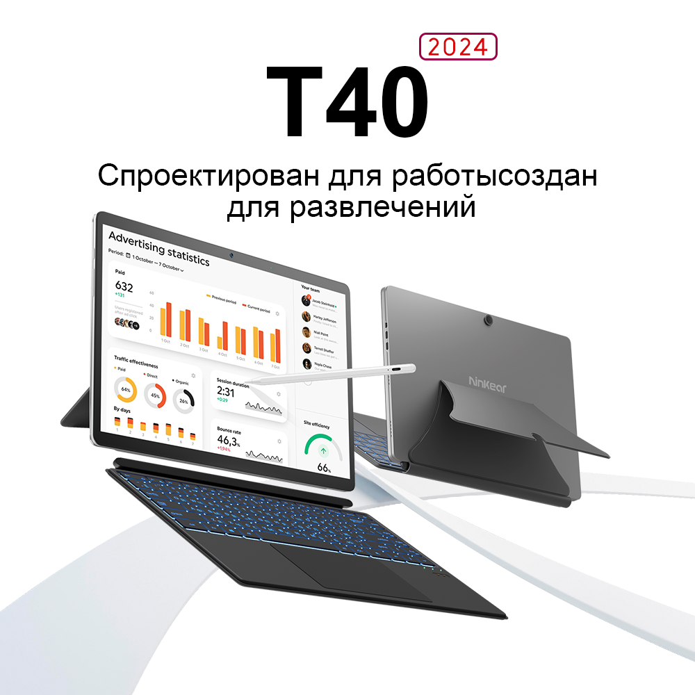

# LaptopAccelRotate

[English](README.md) · **Русский**

<p align="center">
  
</p>

<p align="center">
  <sub>Ninkear T40 (2024) — ноутбук-трансформер, на котором написана и отлажена программа.<br>
  Изображение — рекламное фото производителя.</sub>
</p>

Автоповорот экрана для планшетов и ноутбуков-трансформеров под Windows, у которых
штатный автоповорот не работает, хотя акселерометр исправен.

Программа сама читает датчик и поворачивает **только встроенную панель** — внешние
мониторы остаются как были.

---

## Зачем это нужно

Типичная поломка после переустановки Windows: в системе нет драйвера сенсорного хаба,
который связывает акселерометр с подсистемой автоповорота. При этом сам датчик работает
и честно отдаёт данные — проверить можно так:

```powershell
[void][Windows.Devices.Sensors.Accelerometer, Windows.Devices.Sensors, ContentType = WindowsRuntime]
[Windows.Devices.Sensors.Accelerometer]::GetDefault().GetCurrentReading()
```

Если эта команда возвращает `AccelerationX/Y/Z`, а экран не крутится — эта программа
закроет дыру: она берёт данные напрямую из WinRT и поворачивает экран через WinAPI.

### На чём написана и проверена

Конкретное железо, ради которого всё затевалось, — **Ninkear T40 (2024)**:

| | |
|---|---|
| Процессор | Intel N100 |
| Форм-фактор | планшет со съёмной клавиатурой на магнитах, по Bluetooth |
| Экран | 2K, встроенная панель в системе числится как `\\.\DISPLAY1` |
| Датчик | акселерометр, доступен через WinRT, но без драйвера сенсорного хаба |

На заводской Windows автоповорот работал. После переустановки системы драйвер чипа,
связывающего датчик с автоповоротом, не встал — и штатный автоповорот пропал, хотя сам
акселерометр продолжает исправно отдавать данные. Эта программа заменяет недостающее звено.

Код ничего не знает про конкретную модель и должен работать на любом планшете или
трансформере под Windows с доступным через WinRT акселерометром.

## Что умеет

- Автоповорот по акселерометру, с подавлением дребезга.
- **Поворачивает именно встроенную панель**, а не «основной» экран. Это принципиально:
  если внешний монитор назначен основным, наивная реализация крутит его, а не ноутбук.
- Ручной выбор экрана в интерфейсе, если автоопределение вдруг промахнётся.
- Отслеживает подключение и отключение мониторов (`WM_DISPLAYCHANGE`).
- Переключатель «поменять лево и право» — для матриц, установленных зеркально.
- Автозапуск при входе в Windows, работа из системного трея.
- Ручной поворот из окна, когда автоповорот выключен.
- Права администратора не нужны.

## Как это работает

Две части:

1. **Фоновый процесс** — `powershell.exe` со скриптом `worker.ps1`, который программа сама
   раскладывает в `%LOCALAPPDATA%\AutoRotate\`. Скрипт делает ровно одну вещь: читает
   `Windows.Devices.Sensors.Accelerometer` и печатает `X;Y;Z` в стандартный вывод.
   PowerShell нужен только потому, что через него проще всего добраться до WinRT API
   без сторонних библиотек.

2. **Основное приложение** (`AutoRotate.exe`) — читает этот поток и решает, что делать.
   Вся логика поворота живёт здесь и только здесь.

### Выбор экрана

Ключевой момент. `EnumDisplayDevices` умеет сказать только «этот экран основной», но не
«этот экран встроенный». Поэтому встроенная панель ищется через CCD API
(`QueryDisplayConfig` + `DisplayConfigGetDeviceInfo`) по типу видеовыхода:

| Константа | Значение |
|---|---|
| `DISPLAYCONFIG_OUTPUT_TECHNOLOGY_INTERNAL` | `0x80000000` |
| `DISPLAYCONFIG_OUTPUT_TECHNOLOGY_DISPLAYPORT_EMBEDDED` | `11` |
| `DISPLAYCONFIG_OUTPUT_TECHNOLOGY_UDI_EMBEDDED` | `13` |

Найденный target сопоставляется с GDI-именем вида `\\.\DISPLAY1`, и поворот
через `ChangeDisplaySettingsEx` адресуется строго этому устройству.

Если встроенной панели нет (например, на настольном ПК), программа откатывается
на основной экран.

### Определение ориентации

Из показаний акселерометра:

- `|Z| > 0.88` — устройство лежит плашмя, ориентацию определить нельзя, поворот не трогаем.
- `Y < -0.55` — альбомная, `Y > 0.55` — альбомная перевёрнутая.
- `X < -0.55` и `X > 0.55` — книжные ориентации; какая именно, зависит от галки
  «поменять лево и право».

Поворот применяется только после двух подряд одинаковых отсчётов — иначе экран
дёргался бы на каждом случайном наклоне.

## Сборка

Нужен только .NET Framework 4, который есть в Windows из коробки. Никаких NuGet,
Visual Studio и внешних зависимостей.

```bash
build.bat
```

Батник сам находит `csc.exe` и собирает `AutoRotate.exe` с иконкой. Либо вручную:

```bash
%WINDIR%\Microsoft.NET\Framework64\v4.0.30319\csc.exe /target:winexe /optimize+ /out:AutoRotate.exe /win32icon:AutoRotate.ico /reference:System.dll /reference:System.Drawing.dll /reference:System.Windows.Forms.dll AutoRotate.cs
```

## Использование

Запусти `AutoRotate.exe` двойным кликом и нажми «Включить».

- Закрытие окна сворачивает программу в трей, она продолжает работать.
- Выход — через контекстное меню значка в трее.
- Галка «Запускать при входе в Windows» добавляет программу в автозапуск с ключом
  `/auto` — она стартует свёрнутой и сразу включает слежение.

Ключ командной строки:

| Ключ | Действие |
|---|---|
| `/auto` | Сразу включить автоповорот и свернуться в трей |

## Настройки

Хранятся в `HKEY_CURRENT_USER\Software\AutoRotate`:

| Значение | Тип | Смысл |
|---|---|---|
| `Swap` | DWORD | `1` — поменять лево и право местами (по умолчанию) |
| `Screen` | String | Имя экрана, например `\\.\DISPLAY1`. Пусто — определять встроенный автоматически |

Автозапуск — `HKEY_CURRENT_USER\Software\Microsoft\Windows\CurrentVersion\Run`, значение `AutoRotate`.

## Если не работает

- **Экран не крутится вообще.** Проверь «Блокировку вращения» в Параметрах → Система → Экран.
- **В окне написано «ДАТЧИК НЕ ОТВЕЧАЕТ».** Акселерометр недоступен из WinRT, проверь
  командой из раздела «Зачем это нужно».
- **Крутится не в ту сторону.** Сними или поставь галку «Поменять лево и право».
- **Крутится не тот экран.** Выбери нужный вручную в выпадающем списке «Экран».

## Ограничения

- В режиме **дублирования** экранов повернётся всё сразу. У Windows в этом режиме один
  источник на оба выхода, обойти это нельзя.
- Акселерометр опрашивается по таймеру (каждые 300 мс), а не по событию — так проще
  и надёжнее, но реакция не мгновенная.

## Файлы

| Файл | Что это |
|---|---|
| `AutoRotate.cs` | Весь исходный код, один файл |
| `AutoRotate.ico` | Иконка приложения и трея |
| `build.bat` | Сборка штатным компилятором Windows |
| `docs/` | Картинки для README |
